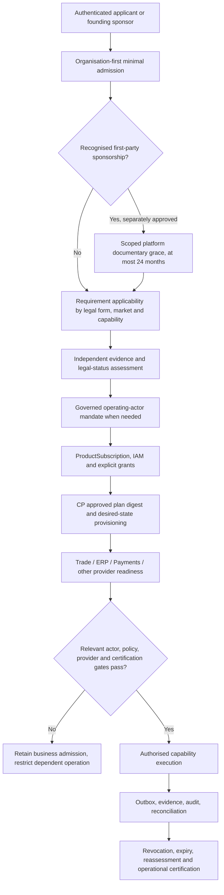

# Baobab Platform Enterprise Architecture Implementation Plan v2.1
## Normative post-ADR-BCP-026/027 reconciliation — proposed revision

**Revision proposed:** 11 October 2026  
**Supersedes for active sequencing:** [EA Implementation Plan v2.0 (30 September 2026)](../adr/Baobab%20Platform%20Enterprise%20Architecture%20Implementation%20Plan%20%E2%80%94%20Revised%202026-09-30.md) upon architecture/governance acceptance.  
**Authority:** Shared is the normative contract authority; Control Plane governs business admission, legal-actor mandate and platform desired state; IAM verifies principals and issues provider-neutral workload identity.  
**Source decisions:** `baobab-cp/docs/adr/ADR-BCP-026 — Progressive Enterprise Onboarding, Founding-Group Exemption and Capability-Specific Evidence Governance.md` and `ADR-BCP-027 — Organisation-First Tenancy, Operating Business, Trading Style and Legal-Actor Responsibility Model.md` (Accepted 9 October 2026).  
**Purpose:** Bring the existing EA-01–EA-13 programme into line with **two later, accepted foundational ADRs**, without erasing earlier technical convergence work or equating a merged PR with a certified live service.

> **Change in architecture baseline:** A Tenant belongs primarily to its canonical Organisation, which need not itself be an incorporated company. A legally responsible actor is a separate, scoped, effective-dated and independently authorised relationship for each operation that requires one. Evidence, documentary deferral, legal status, entitlement, provisioning, live certification and IAM permission remain separate decisions.

## 1. What v2.0 could not have included

Version 2.0 was approved as an implementation sequence on 30 September, **before** both decisions of 9 October. Its conceptual `tenant/legal_entity/market` questions, single foundation unfreeze gate, and older verification-readiness dashboard are therefore insufficient, not intrinsically invalid. It remains a historical architectural baseline, but its completion labels and immediate execution queue are not current progress evidence.

| Area | v2.0 baseline, retained where valid | Mandatory v2.1 change |
|---|---|---|
| Tenant canonical identity | Stable Tenant/LegalEntity mappings | Required PRIMARY Organisation; optional legally justified actor, not fictitious legal entity |
| Incorporation | Verification records | Independent source-backed status; unincorporated businesses retain legitimate Organisation identity |
| Founding-group admission | Enterprise onboarding and INTERNAL classification | Governed sponsorship and **one-time 24-calendar-month** bounded *platform* documentary deferral, not legal waiver |
| Enterprise admission | Evidence/Verification as one workstream | Progressive admission based on purpose, legal form, market, product, role and provider; low-risk account creation must not demand universally irrelevant registrations |
| Responsibility | Tenant + engine accounting | Effective-dated, role/activity/market-scoped OperatingLegalActorMandate; legal actor cannot be derived from brand, tenant owner or corporate chart |
| Cross-engine execution | Canonical context/provider binding | Resolve legal party per operation at Trade, ERP, Payments and documents; capture decision version in historical events and records |
| Readiness | Conformance + operational certification | Split Organisation admission, evidence posture, service eligibility, actor mandate, IAM, entitlement, desired-state provisioning and provider/live authority into *different* gates |
| Frontend unfreeze | Common EA Foundation gate | Add no-authority-in-frontend and progressive journey/actual issuer disclosure; development unfreeze ≠ commercial service authorisation |

## 2. Invariants — all gates fail closed

1. Every operational Tenant has exactly one governed **PRIMARY Organisation** reference; tenancy and business identity persist through later incorporation, sale, rebrand or exit.
2. `legal_entity_id` is optional only where lawful and contract-supported. If a specific action needs a legal person, it MUST resolve an independently established real actor through an active, unique, scoped mandate. No dummy incorporation, no client-provided arbitrary actor override.
3. Founding sponsorship is **not** verified share ownership, operating mandate, IAM membership, INTERNAL entitlement, statutory waiver or active service permission.
4. Only specifically listed *platform* documents may receive a single 24-calendar-month founding-group deferral, measured from recorded provisional approval; no reapply/rename/reprovision reset. Existing shorter deferrals are not silently extended; statutory and provider obligations always apply.
5. An Organisation may be admitted while some capabilities remain inaccessible. Restricted functionality is evaluated per activity/market/provider; no global ‘compliant’ boolean and no blanket business suspension by Regulations.
6. IAM tenancy grants and legal-actor relationships remain orthogonal: parent/legal-actor administration does not grant sibling tenant access; provider-neutral scoped workloads must authenticate and be auditable.
7. CP owns governed canonical decisions, platform admission and provisioning intent. IAM owns identity issuance; Subscriptions owns product classification/entitlement; Trade owns commerce; ERP owns accounting/tax postings; Payments owns PSP execution; Regulations supplies assessments, not blanket enforcement authority.
8. A document-extraction suggestion, scan result, founding declaration or seller trading style **never** becomes verified CIPC incorporation or independently proven SARS/PSP authority by inference.
9. Provider activation, outbox events, capability bindings, EngineRelease compatibility, replay, drift and recovery retain all previously accepted EA v2.0 safety gates.
10. Production readiness requires protected, authenticated staging and external certifications. Passing synthetic PostgreSQL/HTTP tests proves code behaviour only.

## 3. Founding business canonical reference examples

The following are **declared business positions**, not independently verified corporate registry facts:

| Operating Organisation | Declared business form (9 Oct baseline) | Tenant | Legal actor / mandate |
|---|---|---|---|
| Nabhold Group Africa | South African incorporated holding company, independently verify | Independent Nabhold Tenant | Nabhold itself for authorised roles |
| Thamani Global | Declared separately CIPC-registered subsidiary, separately verify registration and control | Independent Thamani Tenant | Thamani where approved; historical Nabhold work does not grant current seller/PSP authority |
| ZuriBeans | Operating business pending separate incorporation | Distinct justified Organisation + Tenant | Proposed Nabhold actor **only for independently authorised activity/role/market mandates** |
| Equator & Estate Co. | Operating business pending separate incorporation | Distinct justified Organisation + Tenant | Proposed Nabhold actor only for approved property/construction/hospitality roles with required permits |

**Option B autonomy remains intact:** each business has separately governed market entry/exit and administration; economic or legal affiliation is never a cross-tenant IAM grant. Later independent incorporation preserves OrganisationID/TenantID and historical seller/issuer/ERP attribution.

## 4. Revised enterprise operating flow



The diagram is a *decision and dependency model*, not proof that every connection is already operational.

## 5. Revised implementation work packages mapped to the original EA programme

| Priority | v2.0 workstream | Post-ADR gate / deliverable | Repository authority | Completion proof |
|---|---|---|---|---|
| P0 | EA-01 Contract convergence | LA-00/01: Organisation-first Tenant identity, legal-actor mapping/mandate references, admission and evidence schema; regenerate consumers; reconcile locks | Shared → CP/IAM/engines | Schema/version/compatibility tests, no stale pin |
| P0 | EA-05 CP governance | LA-02/03/04: additive PostgreSQL migrations, reconciler, mandate registration/approval/revocation, real legal actor ambiguity handling | CP | PG17 concurrency/migration/backfill tests, authority negatives |
| P0 | EA-05 + onboarding | PEO-00/01/02: policy-controlled founding sponsorship, exact enumerated 24-month document deferrals, expiry/review/restriction/release | Shared/CP | Time-zone, anniversary, anti-reset, authoriser SoD and scope tests |
| P0 | EA-05 / evidence | PEO-03/04: progressive external admission and founding registry records; independently verify Nabhold/Thamani registration/control; no invented ZuriBeans/Equator incorporation | CP + authenticated source connectors | Source custody, evidence provenance, case outcomes, applicant-negative tests |
| P0 | EA-04 IAM | Dedicated scoped workload, mTLS/OAuth/federation, assurance and revocation for source/scan/extraction/operating flows | IAM/Shared/CP | Protected token/audience/role and cross-tenant replay tests |
| P0 | EA-02 capability convergence | LA-05 / PEO-05: legal-actor aware capability/provider contracts for Subscriptions, ERP, Trade, Payments and Logistics | Shared + provider repos | Consumer tests; no direct legal-actor bypass, no false provider ACTIVE |
| P0 | EA-03 topology | EngineRelease, DeploymentObservation and immutable compatible provider selection for each legally scoped operation | CP/Shared/Infrastructure | Deploy observation/reconciliation evidence |
| P1 | EA-06 events | Governed outbox, replay, redaction, causal links for sponsorship, mandate, evidence, restriction and actor transition | CP/Shared/consumers | End-to-end exactly-once-effect tests and DLQ/replay |
| P1 | EA-09A certification | Pre-deployment proof: authentic source transport, document scan, custody, verification, provider certification, legal actor and rollback | CP/IAM/engines | Signed conformance matrix, isolated negative test proof |
| P1 | EA-10/11 | Trace actor/tenant/case/mandate/provisioning through telemetry and recovery without emitting personal document contents | Infrastructure/engines | Observable staging drills, RPO/RTO and access audit |
| P1 | EA-12 Console + estates | PEO-06: progressive journey, declared vs verified status, document deferral, responsible seller/issuer and activity-specific restriction UI | CP + digital estates | Contract-backed accessible browser test |
| P1 | EA-13 Regulations | Integrate versioned requirement applicability/assessments without central global veto or premature regulatory source trust | Regulations/Shared/CP | Purpose/market/policy-version tests |
| Exit | EA-09B / qualification | PEO-07 + LA-06/07: onboarding, actor cutover, protected multi-tenant provider and recoverability acceptance | Cross-platform governance | Recorded external certifications and operational go/no-go |

### Explicit PEO-03 evidence subgates

- **PEO-03F–I:** certified official-source transport, signed/immutable versioned custody, authenticated source capture, independently approved SARS-assisted witness. A recorded witness remains non-authorising; CIPC/URSB proof must be genuinely independent.
- **PEO-03H/J/K:** bounded certificate-pinned OCR, worker with current case/claim/evidence + workload authorisation, independently signed malware-scan proof, artifact custody, encrypted non-authorising candidate ledger. No extraction API serves raw documents to clients.
- **PEO-03L (new proposed gate):** protected staging composition and auditable scanner/token, custody/KMS, legal evidence, evidence destruction, redaction, retention and operational negative tests.
- **PEO-03M (new proposed gate):** independently certified external government/PSP source and policy proof; no synthetic approval or proxy CIPC verification.

New gate names PEO-03L/M are **programme planning identifiers** until accepted by CP; this plan does not silently create an ADR, capability or protocol registry key.

## 6. Four distinct readiness decisions

| Decision | Can pass without incorporation? | Required authority |
|---|---|---|
| Organisation and low-risk applicant admission | Yes, where applicable | CP admission + IAM authentic applicant + independent sponsor approval if claimed |
| Business tenant registration / administration | Yes, with PRIMARY Organisation and policy | CP Tenant mapping + IAM grants + provisioning |
| A given regulated transaction or provider capability | Not always; depends on legal form/activity/market/provider and approved operating actor | CP mandate/PEP + Trade/ERP/PSP domain-specific policy |
| Production business/enterprise go-live | Never by admission alone | Independent source/legal/provider approvals + EA-09B ops certification |

A document grace changes only a **specified platform document collection requirement**; it never sets any of these decisions TRUE by itself.

## 7. Revised acceptance matrix (minimum)

| Test/gate | Expected result |
|---|---|
| PEO-T04/T19, LA-T01/T02 | Pre-incorporation ZuriBeans / Equator have valid Organisations and isolated tenants; no fabricated incorporated profile; missing PRIMARY Organisation denied |
| PEO-T05–T09, T08A–C | One-time bounded 24-month, enumerated platform grace; expiry, anti-reset, maker/checker and legal/provider non-waiver |
| PEO-T10/T11/T12/T16; LA-T04/T05/T22 | Parent/affiliate access denied absent tenant grant; sponsorship revocation reviews INTERNAL classification; applicant cannot self-approve |
| PEO-T15/T17/T20, LA-T18/T27 | Nabhold/Thamani incorporation, group control and source provenance separately established; inaccessible provider never yields VERIFIED |
| PEO-T21/T22, LA-T03/T06/T10/T11/T12/T23/T28 | Mandate must be approved and unique by role/activity/market/time; missing, expired, ambiguous or attempted override denies dependent operation |
| LA-T08/T09/T13/T14/T20 | ERP legally correct issuer/accounting company; no invented ledger or retroactive issuer; shared actor across tenants not automatic intercompany revenue |
| PEO-03H/J/K and staging tests | Only genuine independent signed CLEAN scans enter encrypted candidate path; tampered, quarantined or restricted evidence denies; OCR never authorises legal status |
| EA-02/03/04/05 | Provider declared capability/contract version, IAM workload assurance, authoritative Changeset, EngineRelease and readiness all demonstrated |
| EA-06/09A/10/11 | Idempotent event/audit proofs, operational negatives, traceability, replay/drift and recovery tests |
| EA-09B | Real registry/PSP/provider approval + protected staging evidence and operational sign-off, distinct from synthetic CI |

## 8. Admission, development-unfreeze and go-live gates

**Gate A — Architecture/contract readiness:** Shared LA-01 and PEO-01 contracts accepted, pinned by every affected consumer; nullable actor boundary, purpose/role/market-specific mandate, schema migration and proof negative tests converge.

**Gate B — Platform developer-unfreeze:** Retain EA v2.0 Section 38 prerequisites but **extend its explicit development freeze/unfreeze list to Nabhold, ZuriBeans, Thamani and Equator & Estate Co.** (the fourth independently deployed founding digital estate). This v2.1 requirement overrides the older three-name list, not the actual prerequisite controls. Add Organisation-first model + canonical API, mandate policy/service, progressive intake and consumer-ready typed contracts. Selected Digital Estate development can proceed only if frontend does not implement shadow platform authority. *Do not equate with admission or trading permission.*

**Gate C — Controlled founding-group onboarding (non-production):** Create truthful Nabhold, Thamani, ZuriBeans, Equator & Estate Organisations; separately classify incorporation/ownership, only permitted sponsorship, enumerate documentary grace, create isolated tenants, scoped actors and pending capability state; no false verified provider or legal record. Require reversible replay/idempotency.

**Gate D — Capability-specific staging qualification:** A *given* capability can qualify only if CP context, IAM isolation, Subscription entitlement, mandated actor, concrete provider capability contract, certified requirement profile and evidence/operation status are all genuinely accepted. Prove negative and revocation paths.

**Gate E — Production activation (EA-09B):** Actual externally certified source and PSP arrangements, KMS/object custody, CIPC/SARS or other provider approvals where relevant, protected IAM token path, monitored deployment/reconciliation/restore and signed go/no-go. AWS account IDs and secrets are dependencies to be supplied—not test fixtures to invent. No blanket whole-tenant switch inferred from one capability's acceptance.

## 9. Implementation priority and current evidence discipline

This section is a **decision-oriented assessment framework**, not a claim that every PR below is production-certified.

- Accepted ADR-BCP-026/027 supersede contradictory pre-9-October interpretations.
- CP PEO-03F–J implementation, Shared workload scope registry, IAM pin/contract merges and signed-scan/candidate-ledger work shall be assessed by **current merged commit, actual migrated database, tests and signed review evidence**. A branch/PR by itself is *in progress*.
- Latest document custody / PostgreSQL candidate integration (PEO-03K) must pass Go, PostgreSQL migration, Foundation and security tests before its status can advance. Scanner operation, live KMS and live supplier credentials remain separately unproven.
- Independently sourced company facts, mandate authority, PSP certification, real operational evidence, subscriptions/ERP direct-bypass prevention and protected staging MUST NOT be marked complete based solely on a code-level authority abstraction.
- Each gate publishes: commit + contract pin + migration ID + test run + reviewer/authority approval + explicit unmet external dependencies + rollback plan.

## 10. Execution order and revised programme dashboard

```text
A  Contracts & accepted ADR reconciliation (EA-01; LA-00/01; PEO-01)
|   -> Organisation-first Tenant and legal-actor context
v
B  CP legal + evidence governance (EA-05; PEO-02/03; LA-02/03/04)
|   -> recorded sponsorship/grace; evidence, mandate, current lifecycle
v
C  IAM / capabilities / runtime (EA-04 / EA-02 / EA-03 / LA-05 / PEO-05)
|   -> scope/audience, provider support, issuer/merchant roles and isolation
v
D  Cross-engine events / recovery / observability (EA-06 / 10 / 11)
|   -> correct historical actor, no leaking scanned documents
v
E  Synthetic & protected staging acceptance (EA-09A / PEO-03L)
|   -> readiness measured by tested operation and negative evidence
v
F  Controlled founding onboarding (PEO-04 / LA-06) + digital estate unfreeze (EA-12)
|   -> truthful legal forms, separate tenants, explicit restricted capability state
v
G  Actual government / PSP / provider certification + live ops (EA-09B / PEO-03M)
    -> capability-by-capability production authorisation
```

**Dashboard must have separate columns** for *architecture accepted*, *contracts converged*, *code merged*, *database migrated*, *synthetic test passed*, *protected staging passed*, *independent legal/provider evidence accepted* and *operational certification*. Each value is YES / PARTIAL / NO / EXTERNAL DEPENDENCY with a verifiable evidence link. The old September v2.0 dashboard is historical and must not be copied forward as live status.

## 11. Decision requests before marking v2.1 Accepted

1. Confirm the two accepted ADRs explicitly amend and extend EA v2.0; retain all unchanged v2.0 workstreams and the no-premature-production premise.
2. Approve the separate gate sequence and the four readiness decisions above, with no global verified legal status.
3. Confirm the founding group **24-month** deferral, truthful legal-entity posture, Option B autonomy, scope-bound Nabhold mandates, and independent external verification requirement.
4. Approve PEO-03L/M as plan-only gate labels or remap them into existing PEO-03 subgates; never create canonical contracts merely by naming gates in a plan.
5. Assign cross-repository acceptance owners for CP / IAM / Shared / Subscriptions / ERP / Trade / Payments / Infrastructure; only the owning authority may publish its production-support claim.

**Final principle:** Admit organisations progressively; authorise legal actors per operation; grant capabilities explicitly; let engines execute within bounded authority; rely on independently attested evidence; certify actual production operation last.
